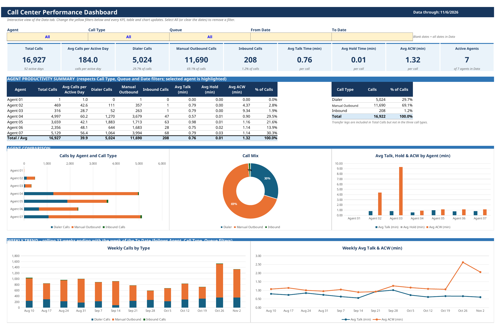

# Agent Performance Dashboard

**Role:** Senior Servicing Analyst, Billing Operations & Collections
**Stack:** Excel / VBA · Snowflake SQL · Amazon Connect export
**Status:** In production — runs regularly

## The problem

Call data was coming out of the dialer and contact platform, but there was no simple way to see by agent, queue, and call type how many calls were handled and how long they took. Questions about agent productivity were being answered by hand.

## What I built

An Excel dashboard on top of the call export. A manager picks an agent, call type, queue, and date range from dropdowns and the dashboard returns counts and averages. A second tab shows the same view weekly for every agent by call type so nothing slips through.

## How it works

1. Load the raw call export into one Data tab using a Snowflake SQL query.
2. Define named ranges for the dropdown selections (agent, type, queue, from, to).
3. Dashboard formula: COUNTIFS on agent, call type, queue and the date window; AVERAGEIFS for handle time.
4. The MECE tab repeats the calcs weekly per agent x call type so totals tie out.
5. Charts read from a helper sheet so they update with the dropdowns.

## Impact

**16,927 calls across 7 agents and 2 queues, Jul 2 – Nov 6, 2026** (92 active days, ~184 calls per active day). Average handle time ~2.1 minutes per call (talk 0.8, after-call work 1.3, hold near zero). Mix: dialer 5,024 calls (29.7%), manual outbound 11,690 (69.1%), inbound 208 (1.2%). Monthly volume held steady around 3,800–4,000 calls (Jul 3,835; Aug 3,963; Sep 3,779; Oct 4,011).

The trend views surface things that used to take hand analysis to spot — after-call work climbed sharply in late October (September averaged 0.98 min; October 1.69 min; the week of Oct 26 hit 2.63 min). Agent productivity questions that were answered by hand are now a dropdown selection.

## Output — format

Excel workbook (Dashboard, Data, weekly MECE tab, helper sheet).

## Files

- `sql/agent-performance-dashboard.sql` — the Snowflake query that loads the Data tab. Agent names and IDs are generic placeholders and the table is shown as FACT_CONTACT only; no real agent identifiers appear anywhere.

## Notes on sharing

Sharing: show code, fully sanitized (rename tables/columns). Agent names and IDs replaced with generic placeholders (Agent 01–07); table shown as FACT_CONTACT only.
