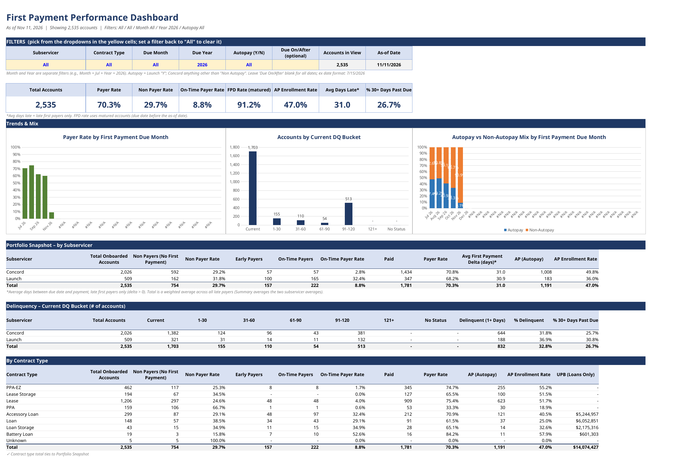

# First Payment Default Dashboard

**Role:** Senior Servicing Analyst, Billing Operations & Collections
**Stack:** Excel / VBA · Salesforce
**Status:** In production — runs regularly

## The problem

Newly onboarded accounts were going to first payment due across two subservicers, and nobody could say quickly how many were actually paying, how many were in autopay, and how long late payers took to pay. Leadership and the investor side kept asking, and the answer lived in two different data feeds that don't line up.

## What I built

An Excel workbook that tracks each onboarding batch from boarding through first payment and rolls it into a dashboard: payer rate, non-payers, autopay vs. non-autopay, and average days from due date to payment, by batch. Updated versions get posted to the performance channel on request.

## How it works

1. Pull the onboarding batches (WIP tracker) and the first-due/first-payment data from each subservicer into one sheet per servicer.
2. Flag each loan in a helper sheet (in-batch, subservicer, non-payer, days-late delta) so the dashboard can use simple named-range formulas.
3. Dashboard counts and averages by batch with COUNTIFS / AVERAGEIFS — for example, payers = COUNTIFS(in-batch, 1, subservicer, X, non-payer, 1) and average delay = AVERAGEIFS(delta, in-batch, 1, subservicer, X, delta, ">0").
4. Handle the autopay field per servicer: Launch uses a Y flag; Concord uses an enrollment status where anything other than 'Non Autopay' counts.
5. A Summary tab rolls the batches together; the workbook is refreshed and re-posted when someone asks.

### Data picture

On 2026-10-31 I reported the payer rate had moved from 23% to 32% across both subservicers, delivered the same day it was requested.

## Impact

~7,000 newly onboarded accounts. It runs daily.

### What the dashboard shows now (Nov 11, 2026)

- **All completed WIP: 7,322 accounts — payer rate 83.2%, autopay enrollment 69.2%.** Batches due on or after Jul 15, 2026 (2,535 accounts): payer rate 70.3%, autopay enrollment 47.0%.
- **Current view (All subservicers, 2,535 accounts): payer rate 70.3%, non-payer rate 29.7%, on-time payer rate 8.8%.** First-payment default rate (matured accounts) 91.2%; average days late among late first payers 31.0 days; 26.7% of accounts 30+ days past due. Concord accounts for 2,026 of the 2,535 (70.8% payer rate); Launch is 509 (68.2%).
- **The autopay effect is visible in the numbers:** in the July 2026 batch (2,310 accounts), the first-payment default rate was 88.8% for autopay accounts vs. 93.4% for non-autopay accounts. Across all batches, 89.2% vs. 93.0%. The effect is much stronger within Launch alone, where the July batch showed 44.1% vs. 82.2% — the combined view is dominated by Concord's large July batch (1,828 of the 2,310 July accounts).

## Output — format

Excel workbook with Dashboard, Summary, per-servicer data tabs and a helper sheet; charts for payer rate by batch.

## Files

- The workbook itself contains real account data and is not published.

## Notes on sharing

Sharing: show code, table names only — no schemas. There is no code in this project; the logic is the workbook formulas described above.
